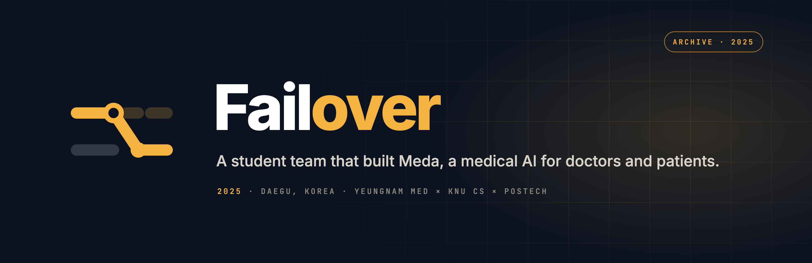
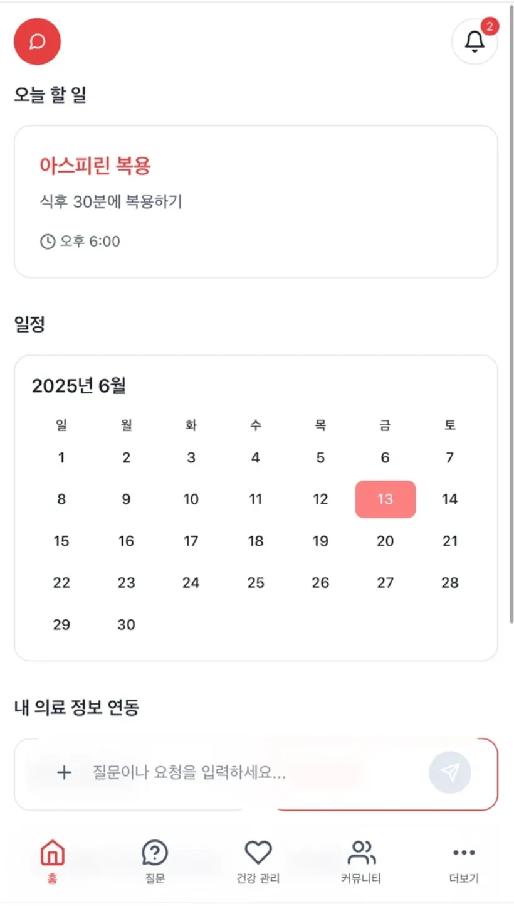

**2025년 대구, 네 명의 대학생이 “의료의 모든 것을 하나의 서비스 위에” 올리려 했던 기록.**
*A four-person student team that built **Meda**, a medical AI for doctors and patients. Archived.*

[**Read the archive →**](https://project-failover.github.io/failover/)

## What Failover was

- **The name.** A failover is the standby system that takes over the moment the primary one breaks, so service never stops. The team wanted medicine to feel like that: connected and working even when something goes wrong.
- **The product, Meda.** Two sides of one service. For doctors, a per-physician medical LLM built *with* each doctor rather than a generic one. For patients, an AI agent that holds every record, medication, visit and bill, and acts on them: booking, reminding, answering.
- **Where it got to.** A mobile web MVP (React · TypeScript · Vite), a team site, and 15+ physicians cooperating by June 2025. Then exams, and everyone went their own way.

  

## Team

| | | |
|---|---|---|
| [ @Allowe1](https://github.com/Allowe1) | [ @GyuminBae](https://github.com/GyuminBae) | [ @NewestAF](https://github.com/NewestAF) |
| Head of team · Med | Software · CS | Engineering |

Yeungnam Med × KNU CS × POSTECH · Daegu, Korea · 2025.06

## Repositories

- [`failover`](https://github.com/project-failover/failover) — the archive site (static, GitHub Pages) and the brand assets. The June 2025 Vite site is in its history.
- `meda-web-mvp`, `beforeaftersample` — private.

support@failover.info · The mark: the primary line fails, the standby line takes over.
